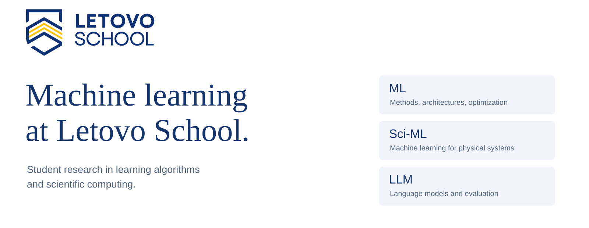

  

[Hugging Face](https://huggingface.co/Letovo) &nbsp; · &nbsp; [Letovo School](https://letovo.ru/)

Our interests include machine learning methods, scientific applications and language models.

## Projects

### WFNO / Coupled
Fourier–wavelet neural operators with information exchange between coarse features and local details.

### NS Lab
A research application for visualizing flow predictions and comparing model errors.

По-русски

Исследования и школьные проекты в области машинного обучения в **Летово**. Основные интересы — ML, научное машинное обучение и языковые модели.

**WFNO / Coupled** — Фурье-вейвлетный нейронный оператор. **NS Lab** — приложение для визуального анализа прогнозов физических полей и ошибок моделей.

